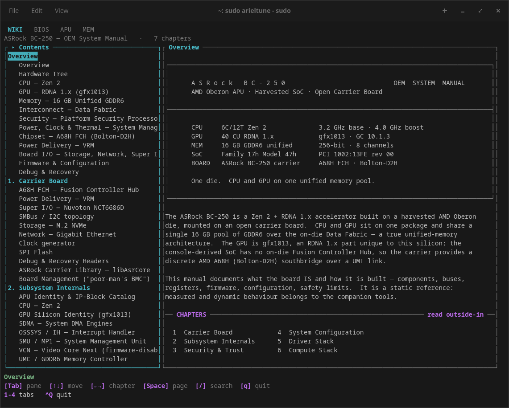
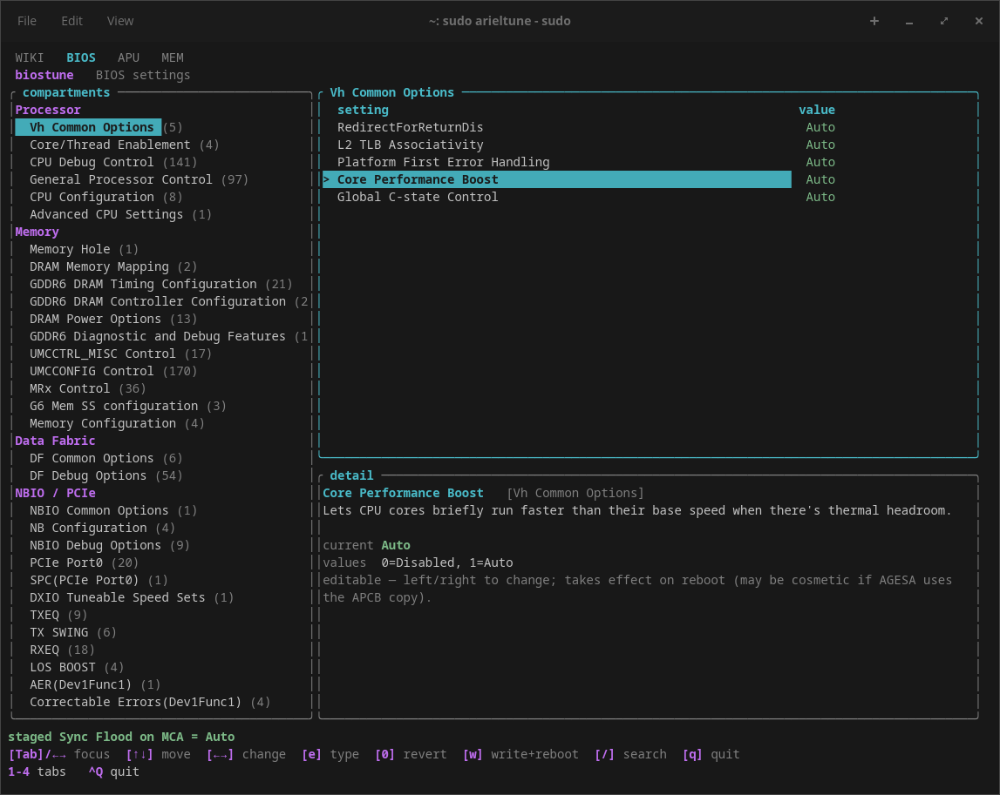
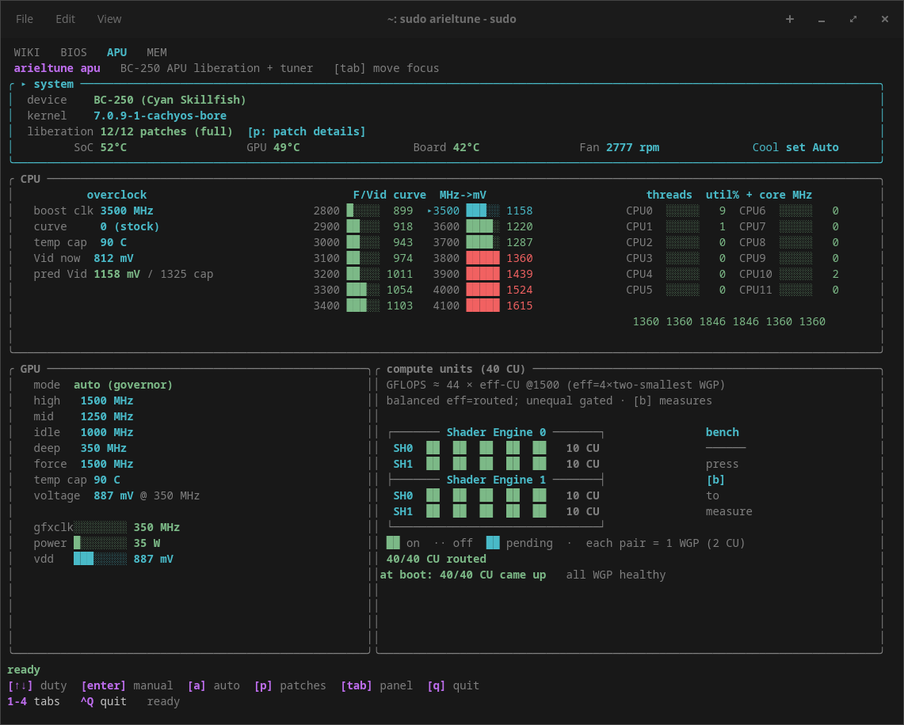
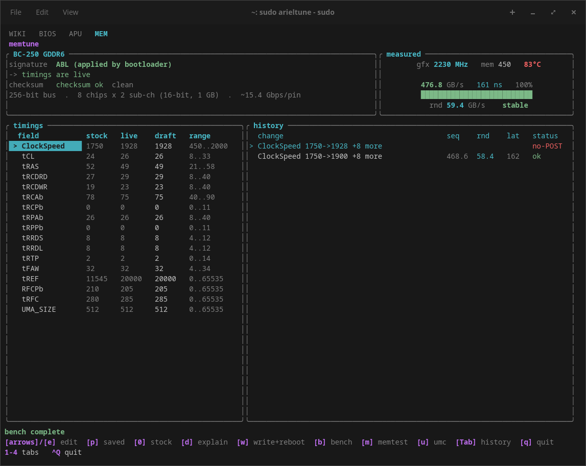
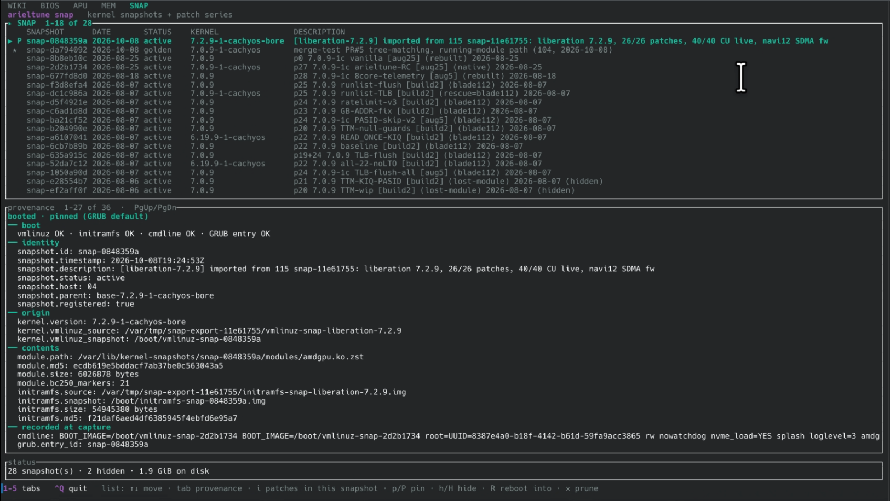

# arieltune

The unified BC-250 tuning suite. One tabbed TUI, with a matching CLI, over five tools:

- **WIKI**: the BC-250 knowledge manual
- **BIOS**: the AMD CBS + OEM Setup surface
- **APU**: APU liberation plus CPU/GPU/CU tuner
- **MEM**: GDDR6 memory-timing tuner
- **SNAP**: kernel snapshots and the patch series (`snaptune`) - the dev path

"Ariel" is AMD's codename for the BC-250's APU (Cyan Skillfish, gfx1013). The suite is named for the chip, not the board.

<table>
  <tr>
    <td align="center"><b>WIKI</b><br></td>
    <td align="center"><b>BIOS</b><br></td>
  </tr>
  <tr>
    <td align="center"><b>APU</b><br></td>
    <td align="center"><b>MEM</b><br></td>
  </tr>
  <tr>
    <td align="center" colspan="2"><b>SNAP</b><br></td>
  </tr>
</table>

## Why

The stock amdgpu driver keeps the BC-250 harvested: 24 CUs, locked clocks. arieltune ships a curated amdgpu kernel patch series that unlocks all 40 CUs, adds race-free SMU clock control, CPU clock limits, and live telemetry. It drives the whole kernel build and install for you: roughly a 1 hour build plus a reboot, always previewed first, and it only acts with `--run`.

Build the series against `linux-cachyos-bore` 7.2.9-1 (the `linux-cachyos-bore/` PKGBUILD dir - the plain `linux-cachyos/` dir builds a kernel release string the prebuilt nct6687 fan-telemetry module's vermagic won't match; the prebuilt module must match whichever release you target). **7.2.9 is the default target; 7.0.9 is still supported.** Both series, both prebuilt nct6687 modules and both PKGBUILD pins ship inside the same binary, so pick the kernel you are validating with `aputune build --kernel 7.0.9` (or `APUTUNE_KERNEL=709`) - a snapshot can then drift between the two kernels without swapping tools, which is what makes an A/B run measure the kernel rather than the binary. 7.0.9 needs the rust target-ABI shim, which `aputune` injects automatically when it probes a rustc that rejects the pre-rename `x86-softfloat` spelling (1.99+); 7.2.9 already carries the renamed `softfloat` spec. The per-kernel series lives in `crates/apu/patches/bc250-cachyos-<version>/`; every diff and what it does is explained in that directory's `SERIES.md` (patches that are on disk but not applied are marked there).

### Build dependencies

On Arch/CachyOS the distro Rust toolchain is enough — no rustup needed. On other
distros, install Rust via [rustup.rs](https://rustup.rs) first. The patched-kernel
build then needs `gcc15`, `bc`, `base-devel`, `pahole`, and the kernel-Rust pieces
(`rust`, `rust-bindgen`, `rust-src` — the shipped 7.2.9 config has `CONFIG_RUST=y`).
`mkinitcpio` ships by default on CachyOS. On a fresh install, sync mirrors first - a live
ISO's package database can be stale enough that a needed package 404s:

```sh
sudo pacman -Syyu
sudo pacman -S --needed gcc15 bc base-devel pahole rust rust-bindgen rust-src
```

The kernel build is **gcc**, not clang. The PKGBUILD gates
`CC=clang LD=ld.lld LLVM=1 LLVM_IAS=1` behind `_is_lto_kernel` — `_use_llvm_lto`
being `thin`/`full`/`thin-dist` — and defaults that to `none`. The shipped 7.2.9
config agrees (`CONFIG_CC_IS_GCC=y` with `CONFIG_LTO_NONE=y`) and the running
kernel reports `gcc`, so a stock build never invokes an LLVM tool. Add
`clang llvm lld` only if you deliberately build an LLVM-LTO flavour: `arieltune`
reads `_use_llvm_lto` from the PKGBUILD and requires them for exactly those, so a
stock build no longer stops on a "missing clang" it was never going to call.

`arieltune apu build` pre-flight-checks the toolchain before touching anything and
aborts in seconds with the exact missing packages instead of failing deep into the
~1 hour build.

#### Kernel Rust on a newer rustc

The shipped 7.2.9 config has `CONFIG_RUST=y`, and older kernels hard-code the Rust
target-spec ABI in `scripts/generate_rust_target.rs` as `x86-softfloat` — a
spelling rustc has since renamed to `softfloat`. A rustc new enough to reject the
old name kills the build before it produces anything, inside `prepare()`
(`rust/Makefile` -> `rust/core.o`):

```
error: error loading target specification: rustc-abi: invalid rustc abi:
'x86-softfloat'. allowed values: 'x86-sse2', 'powerpc-spe', 'softfloat'
```

`x86-sse2` appears in that list but is **not** the replacement — x86-64 rejects it
with *invalid x86-64 Rust-specific ABI and `cfg(target_abi)` combination*.
`softfloat` is the renamed value, and is what rustc's own builtin
`x86_64-unknown-none` spec already carries.

This is toolchain skew, not a project-ariel bug: `rust`, `rust-bindgen` and
`rust-src` are installed exactly as documented above, and the build still fails.

`aputune build` fixes it, and tells you which case you are in:

```
kernel Rust: rustc accepts the kernel's target ABI (softfloat)
kernel Rust: rustc rejects the kernel's target ABI (x86-softfloat) — injected
             0002-rust-abi-rename.patch; CONFIG_RUST stays on and the PKGBUILD is
             restored when this build ends
```

It never guesses versions — it asks rustc. It reads rustc's own builtin target
spec, forces the ABI value to the kernel's spelling, and asks rustc to load the
result. If rustc accepts it, nothing is changed — so a newer bore kernel that no
longer needs the fix is handled with no change to arieltune.

Kernel Rust is **kept on**: the fix renames the ABI value rather than disabling
Rust. The patch travels through `source[]`/`b2sums[]` because that is the only
channel the PKGBUILD's own `prepare()` applies before the build reaches
`rust/core.o`. `config` is left untouched, the PKGBUILD is restored byte for byte
when the build finishes, and `aputune patches` still counts only the liberation
series — this shim unlocks no silicon and carries no runtime tell.

## Quick start

Needs Rust (see *Build dependencies* above) and sudo.

```sh
git clone https://github.com/cachenetics/project-ariel.git
cd project-ariel
./install.sh    # release build + install to /usr/local/bin
arieltune       # launch the TUI (opens on WIKI)
```

Installs one binary, an `at` alias, and `aputune`/`memtune`/`biostune`/`wikitune` compat symlinks.

```sh
arieltune apu          # jump straight to a tab (or: arieltune --tab mem)
arieltune apu <cmd>    # per-app CLI
```

TUI keys: `1`-`5` (or `F1`-`F5`) jump tabs, `Ctrl-Tab` cycles, `Ctrl-Q` quits.

### Liberation quick start (patched kernel)

The end-to-end flow from a fresh CachyOS BC-250 to a fully unlocked board:

1. **BIOS**: set *UMA Frame Buffer Size* to **512M**. A different carve (e.g. 2G)
   breaks IP discovery and every PSP firmware load (`LOAD_IP_FW ... 0xFFFF0008`) —
   failures that look like patch bugs. The preflight reads the live carve and
   blocks the build until the BIOS is fixed.

2. **Pin a linux-cachyos PKGBUILD** (arieltune cannot fetch this itself). Both
   series ship inside the binary, so pin whichever kernel you are validating —
   7.2.9 is the default and 7.0.9 is still supported:

   ```sh
   git clone https://github.com/CachyOS/linux-cachyos.git ~/linux-cachyos

   # 7.2.9 (default) — builds release 7.2.9-1-cachyos-bore
   git -C ~/linux-cachyos checkout b11ba14854d9748bdb3e3daf7a90e8d3a31004ec

   # ...or 7.0.9 — builds release 7.0.9-1-cachyos-bore
   git -C ~/linux-cachyos checkout 791fb8ea6d3cf7c85e596678c25c56fa140591be
   ```

   Both build from the same `linux-cachyos-bore/` PKGBUILD; the version is what
   separates them, and step 4 refuses a tree that does not match the kernel you
   asked for.

3. **Arm the fleet kernel command line.** Without it the PSP rejects every
   firmware load and most patch features report dead. CachyOS installs default
   to GRUB, but a fresh install can also come with Limine instead - if you are
   not sure which you have, `test -f /etc/default/grub && echo grub || echo limine`.

   **GRUB:**

   ```sh
   sudo sed -i 's|^GRUB_CMDLINE_LINUX_DEFAULT=.*|GRUB_CMDLINE_LINUX_DEFAULT="nowatchdog nvme_load=YES splash loglevel=3 amdgpu.ppfeaturemask=0xfff77ef7 amdgpu.noretry=0 amdgpu.gpu_recovery=1 amdgpu.sched_hw_submission=2 mitigations=off ttm.pages_limit=3588867 ttm.page_pool_size=3588867 iommu=pt amd_iommu=on amdgpu.bc250_flush_by_runlist=1 amdgpu.bc250_sdma_fw=navi12"|' /etc/default/grub
   sudo grub-mkconfig -o /boot/grub/grub.cfg
   ```

   The `sed` replaces `GRUB_CMDLINE_LINUX_DEFAULT` wholesale - that is the fleet
   baseline. If your host carries other boot flags (disk encryption, `resume=`,
   GPU quirks), merge them into the same line manually instead of clobbering
   them. `mitigations=off` is a throughput choice for dedicated inference
   blades, not a liberation requirement: omit it (keep the kernel's default
   mitigations) if the host is not a dedicated inference box.

   **Limine:** edit `/etc/default/limine` and set the same flags on the
   `KERNEL_CMDLINE[default]` entry ([CachyOS's own bootloader-config docs](https://wiki.cachyos.org/configuration/boot_manager_configuration/)):

   ```
   KERNEL_CMDLINE[default]="nowatchdog nvme_load=YES splash loglevel=3 amdgpu.ppfeaturemask=0xfff77ef7 amdgpu.noretry=0 amdgpu.gpu_recovery=1 amdgpu.sched_hw_submission=2 mitigations=off ttm.pages_limit=3588867 ttm.page_pool_size=3588867 iommu=pt amd_iommu=on amdgpu.bc250_flush_by_runlist=1 amdgpu.bc250_sdma_fw=navi12"
   ```

   then `sudo limine-mkinitcpio` to apply. Same caveats as GRUB above: merge in
   any existing flags instead of clobbering them, and drop `mitigations=off`
   unless this is a dedicated inference box.

4. **Preview, then run the build** (~1 hour; nothing is touched without `--run`).
   `--kernel` selects the series, the embedded nct6687 module and the PKGBUILD pin.
   7.2.9 is the default, so the flag is only needed for 7.0.9:

   ```sh
   # 7.2.9 (default)
   sudo aputune build --pkgbuild ~/linux-cachyos/linux-cachyos-bore          # preview
   sudo aputune build --pkgbuild ~/linux-cachyos/linux-cachyos-bore --run    # go

   # 7.0.9 — same PKGBUILD dir, older pin
   sudo aputune build --kernel 7.0.9 --pkgbuild ~/linux-cachyos/linux-cachyos-bore --run
   ```

   The build states its target before doing anything, and refuses a PKGBUILD whose
   version does not match `--kernel` — so a mismatched pair fails immediately
   instead of hunk-by-hunk after the expensive steps have run.

   **The build does not unlock the GPU by itself.** 40-CU routing is opt-in: the
   install writes `bc250_cc_write_mode=0`, so the first boot is a 24-CU kernel you
   can trust, and you arm 40 CU separately:

   ```sh
   sudo arieltune apu cu status    # is 40-CU armed / persisted / routed
   sudo arieltune apu cu enable    # persist it; takes effect on the NEXT boot
   ```

   `--full` arms it during the install instead (`bc250_cc_write_mode=3`). Staying at
   24 CU for the first boot keeps two experiments apart: a bad route and a bad kernel
   otherwise fail the same way.

5. **Reboot and verify**:

   ```sh
   sudo reboot
   sudo aputune doctor        # expect all checks live and 40/40 CUs

   `aputune doctor` reports the series for whichever kernel is booted, and the
   APU tab names it in the patch list — so a validation run always says which
   half of the pair it is measuring.
   ```

The build installs the kernel, arms `/etc/modprobe.d/aputune-40cu.conf`, and
regenerates the initramfs for you.

## The dev path - snaptune (the SNAP tab)

> **New to this board? Do the Liberation quick start above.** snaptune is not an install
> path and not a second way in. It is what you reach for *after* a liberated board is
> running, when the thing you want to change is the `amdgpu` module and a ~1 hour kernel
> build per attempt is too slow to iterate with.

The SNAP tab - `arieltune snap`, or the standalone `snaptune` - manages the blade's
**kernel snapshots** and shows the liberation series each one carries.


### Why snapshots, on this board

The `amdgpu` module lives in the **early** cpio archive of the initramfs, because early KMS
needs it before the real root is mounted. The running kernel therefore has no record of
which module it loaded: *"which build is this boot running?"* cannot be answered from the
live system at all, only from the artefacts on disk. That is what a snapshot is - one
`amdgpu` module, one initramfs, one kernel, named by a hash of their content.

And because the artefact is a copy, the safe edit is not "change the module and hope". You
make a *different* artefact, name it, and boot it once.

### The dev loop - a module build in about a minute

`snap dev` rebuilds **only the module** (`make M=drivers/gpu/drm/amd/amdgpu modules` -
timestamp-driven, so only what changed relinks) and derives a boot image from a parent
snapshot. It never writes the live module tree, and the base kernel stays bootable.

```sh
# 1. What would this build? Nothing runs.
snaptune dev "patch 25 variant" --tree ~/linux-cachyos/src/cachyos-7.2.9-2

# 2. Build it, derive an image from the parent, verify the member bytes.
snaptune dev "patch 25 variant" --tree ~/... --run

# 3. Make it a real snapshot: id, manifest, /boot artefacts, GRUB entry.
sudo snaptune dev "patch 25 variant" --tree ~/... --run --register

# 4. Boot it once. It reverts by itself on the next boot.
sudo snaptune boot snap-1a2b3c4d
```

Step 2 is the part that matters: the derived image is opened and the member is compared
**byte for byte** with what the build produced. *"The image carries the module I built"* is
a fact, not an inference. `dev` also refuses when the tree would build a *different* kernel
from the one the parent boots, because that module would be refused at load.

The whole cycle - edit, rebuild, register, boot, measure - is about two minutes, against
~1 hour for a full `aputune build`.

### Provenance - what a snapshot records

The lower pane is the manifest of whatever is selected above. `snap dev` records what the
build actually did, not merely what it could not say:

| field | what it tells you |
|---|---|
| `snapshot.id` | `snap-` + a hash of the module, initramfs, vmlinuz and symvers - **content-addressed**, so it cannot drift |
| `snapshot.parent` | the snapshot this was derived from; `lineage` walks the whole chain |
| `snapshot.registered`, `.status` | whether this is a real bootable entry or an unregistered artefact |
| `kernel.version` | the release string the module will load under |
| `kernel.vmlinuz_source` -> `.vmlinuz_snapshot` | where the boot image came from, and where it went |
| `module.md5`, `.size`, `.bc250_markers` | the module's identity. `bc250_markers` counts the `BC-250` tells in the binary, so a snapshot that *claims* the series is patched can be checked against the bytes |
| `initramfs.md5`, `.size` | the image, so the boot pair is verifiable |
| `grub.entry_id` | the menu entry this snapshot owns |
| `cmdline` | the cmdline **live at capture time** - recorded for the record, and explicitly *not* safe to boot with: it can name whichever kernel was booted then, and can carry `BOOT_IMAGE=` twice |

The top of the pane is a boot check - `vmlinuz OK` / `initramfs OK` / `cmdline OK` /
`GRUB entry OK`. `i` opens the liberation series that snapshot carries, with the local edit
marked. `snap verify <id>` re-derives the id from the files; `snap doctor` asks whether the
*store* is coherent. `snap validate <module>` answers the different question of whether a
module is patched, and whether it is the one running.

### Safety

- **`boot` is one-shot.** It arms the *next* boot only, and the boot after it reverts. A bad
  module cannot strand a blade.
- **`pin` is separate and deliberate.** Nothing sets the GRUB default as a side effect of
  anything else - `create` does not promote, and `boot` does not persist.
- **No in-place rebuild.** `rebuild` produces a **new** snapshot; the one you are booted
  from is never touched.
- **`create` does not mutate the live system.** It builds or adopts a module and writes a
  new snapshot beside the existing ones.
- **Every writing verb takes `--dry-run`**, which prints the action plan and touches nothing.

### Verbs

Read-only, safe anywhere: `list` `show` `current` `lineage` `grub-list` `diff` `golden`
`doctor` `verify` `validate` `extract-modules`.

Need root: `dev --run --register` `create` `rebuild` `register` `test-result` `preserve`
`boot` `pin` / `unpin` `hide` / `unhide` `grub-flatten` `prune`.

`--json` is global and puts one JSON value on stdout and nothing else, for scripting.
`verify` exits **2** when anything failed, `doctor --verify` likewise, and
`create`/`rebuild`/`dev` return 2 when they refuse to build - a refusal always writes
nothing. `list --all` includes hidden snapshots. Snapshot ids complete on `TAB`, and
`snapshot` is another name for the same binary, so `snapshot <verb>` works too.

### Help and the full reference

| | |
|---|---|
| [`docs/snaptune.md`](docs/snaptune.md) | the architecture, every verb, the workflows, and the on-disk rules. **Read §8 before changing anything** - it is the backward-compatibility section, and every snapshot on a real blade depends on the contracts in it |
| `snaptune --help` | built-in help - `snaptune <verb> --help` for any verb above |
| [`completions/snaptune.bash`](completions/snaptune.bash) | TAB completion for verbs, flags and snapshot ids |

## What gets unlocked

| Feature | Where | Notes |
|---|---|---|
| **40-CU GPU unlock** | `sudo aputune build --run` + reboot | `aputune doctor` verifies 40/40 CUs active |
| **8-core CPU unlock** | `arieltune apu cores` / TUI Core Map | Per-core control: deactivate the factory-set cores, force-unlock abnormal core layouts, Core Map view of the shader-array topology |
| **SDMA firmware override** | automatic (build) | navi12 SDMA blobs + early TRAP enable, armed via `/etc/modprobe.d/aputune-40cu.conf` |
| **Race-free clock control** | `arieltune apu` TUI / CLI | SMU gfxclk/cclk soft limits with live telemetry |
| **PMFW telemetry** | `arieltune apu` | Clocks, WGP states, pstates, voltages (debugfs nodes shipped by the series) |
| **Memory tuning** | `arieltune mem` | GDDR6 timing tuner (CMOS-backed) |
| **Firmware surface** | `arieltune bios` | AMD CBS + OEM Setup surface |

Every TUI tab has a matching CLI (`aputune`, `memtune`, `biostune`, `wikitune`).

## The one rule

**arieltune must be the only thing driving the SMU.** The APU tab talks to the GPU/CPU power silicon over the single SMU (MP1) mailbox. A second actuator racing it means crippled throughput, wrong clocks, or a wedged GPU that needs a power-cycle. Install on a clean Linux, or first remove any competing clock/power controllers (old `dpm_daemon`, `bc250_smu`, miner clock tools, corectrl, cpupower governors) and reboot.

Also know: the APU, MEM, and BIOS tabs write real hardware (SMU, CMOS/NVRAM, SPI flash). A bad value can fail to POST and need a CMOS-clear. Actuation requires root, the 40-CU and telemetry features require the patched amdgpu, and you use this at your own risk.

## Acknowledgments

arieltune stands on prior BC-250 community work. With thanks:

- **the bc250-collective** (**mrfrakes** and **dantistnfs**) for starting the BC-250
  effort - the original board bring-up, SMU mailboxing, and enablement groundwork that
  everything here builds on.
- **duggasco** for the CU-unlock research - the 40-CU enumeration/dispatch investigation
  on Cyan Skillfish.
- **WinnieLV** for the BC-250 live CU manager, whose proven `apply_target_masks` register
  sequence this project ports (`crates/apu/src/curoute.rs`).
- **ethkey** for sharing the memory-timing tool and timing configurations the **MEM** tab
  is built on; the ASRock `bc250_memcfg` tool and the RobinMemTiming work for the CMOS
  layout and timing semantics; and **walkjivefly** for taking the first plunge.

Building on that, we contribute our **CU map** back to the commons - the shader-array
topology and the empirical dispatch model (`effective_CU = 4 × min(SE0, SE1) WGP total`,
i.e. throughput is gated by the weaker shader engine) that predicts real throughput from a
CU routing. See [`docs/bc250-cu-map.md`](docs/bc250-cu-map.md).

## License

GPL-2.0-only for the whole suite, matching upstream cachenetics/project-ariel.
Kernel-derived subtrees (`crates/apu/patches`, `crates/apu/kmod/nct6687-bc250`,
`crates/bios/driver`) remain GPL-2.0 — the same license. See `LICENSE` and
`THIRD_PARTY_NOTICES`.
